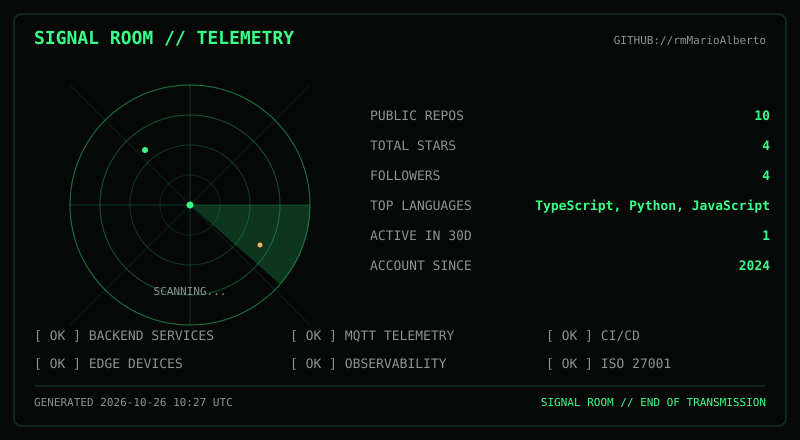
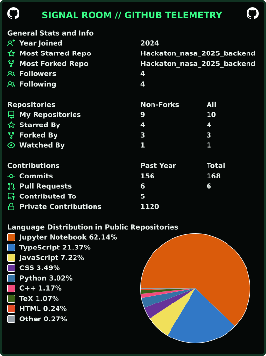

<div align="center">

# SIGNAL ROOM

### BACKEND & IoT DEVELOPER · QUERÉTARO, MX

[](https://github.com/DenverCoder1/readme-typing-svg)

[Portafolio](https://mario-ramirez.dev) ·
[LinkedIn](https://linkedin.com/in/mario-alberto-ramirez-martinez-12215b34a) ·
[Correo](mailto:rmmarioalberto08@gmail.com)

</div>

---

## `> SYSTEM STATUS`

```text
┌──────────────────────────────────────────────────────────────┐
│ SIGNAL ROOM // SOFTWARE & CONNECTED SYSTEMS                  │
├──────────────────────────────────────────────────────────────┤
│ LOCATION      QUERÉTARO, MX                                  │
│ ROLE          SOFTWARE DEVELOPER · BACKEND & IoT             │
│ FOCUS         WEB SERVICES · CONNECTED DEVICES               │
│ EDUCATION     UTEQ · EXPECTED GRADUATION APR 2027            │
│ EXCHANGE      FRAUNHOFER IIS · MIOTY · LOW-POWER DESIGN      │
└──────────────────────────────────────────────────────────────┘
```

Desarrollador de software enfocado en backend y sistemas conectados. He trabajado en aplicaciones para clientes, telemetría MQTT y despliegues en servidores físicos y VPS. Actualmente curso Ingeniería en Desarrollo y Gestión de Software en UTEQ.

---

## `> LIVE TELEMETRY`

<p align="center">



</p>

<p align="center">

<a href="https://github.com/cicirello/user-statistician"></a>

</p>

<p align="center">


</p>

---

## `> CORE STACK`


---

## `> OPERATIONS`

```text
[ BACKEND ] TypeScript · Node.js · NestJS · Java · Spring Boot
[ IoT     ] MQTT · MIOTY · ESP32 · OTA
[ DATA    ] PostgreSQL · PostGIS · Redis
[ DELIVERY] Docker · GitHub Actions · VPS · physical servers
```

---

## `> SELECTED PROJECTS`

### `01 // EMERGENCY RESPONSE` — GeoCESAR

Plataforma en desarrollo para emergencias rurales. Busca conectar solicitudes de ayuda con equipos de respuesta, compartir la ubicación de las personas y facilitar el seguimiento de cada incidente.

**Stack:** Java · Spring Boot · React · React Native · MIOTY · PostGIS

### `02 // ENTERPRISE B2B` — CEQ Marketplace

Marketplace B2B del Clúster Energético de Querétaro. Lideré un equipo de cuatro personas y desarrollé módulos full stack para una plataforma desplegada en VPS. La landing es pública; las funciones requieren autenticación.

**Stack:** NestJS · React · PostgreSQL · Redis · VPS

### `03 // IoT TELEMETRY` — IMOX Cloud

Backend de telemetría MQTT para calidad eléctrica, desplegado con Docker en un servidor físico de recursos limitados. Atendió más de 50 dispositivos concurrentes con intervalos de 1.5 segundos; la validación de timestamps ayudó a evitar falsas desconexiones. También implementé OTA y caché Redis.

**Stack:** NestJS · MQTT · Redis · Docker · OTA

### `04 // GYM MANAGEMENT` — Fitness Gym

Sistema de membresías, acceso con QR, inventario y reportes para un gimnasio de más de 150 miembros.

**Stack:** Angular · NestJS · PostgreSQL · Serverless

### `05 // SOFTWARE & DIGITAL SERVICES` — Linkore Solutions

Iniciativa personal para desarrollar soluciones de software, IoT y marketing digital para clientes.

**Stack:** Next.js · Tailwind · Framer Motion · Meta Ads

### `06 // RURAL HEALTH` — VozRural

Proyecto de hackathon enfocado en telemedicina para comunidades rurales mediante interacción por voz y WhatsApp. Incluyó una prueba de concepto de wearable con GPS.

**Stack:** Node.js · ESP32 · WhatsApp

### `07 // AGRICULTURAL AI` — Lettucecurity

Prototipo de monitoreo agrícola que exploró la detección visual de plagas y la predicción de variables ambientales con modelos de aprendizaje automático.

**Stack:** NestJS · TensorFlow · React · MQTT

> [Explora el portfolio completo — SIGNAL ROOM](https://mario-ramirez.dev) ·
> [Repositorio del portfolio](https://github.com/rmMarioAlberto/mario-ramirez-dev)

---

## `> EXPERIENCE & COMMUNITY`

- **Atlas Copco Mexicana** — Practicante de bases de datos y Power Platform · mar. 2025–mar. 2026. Digitalicé reportes de mantenimiento y construí servicios Node.js para sincronizar datos cifrados con sistemas heredados.
- **IEEE Student Branch · UTEQ** — Miembro desde 2026; impulso la organización del primer hackathon institucional de la universidad. El evento está en preparación.

---

## `> EDUCATION / SIGNALS`

```text
UTEQ ENGINEERING
├── Desarrollo y Gestión de Software · graduación prevista abr. 2027
├── Promedio: 9.54 / 10
└── TSU · Desarrollo de Software Multiplataforma (2021–2023)

FRAUNHOFER IIS · NUREMBERG, GERMANY
├── Intercambio académico · MIOTY
└── Diseño de endpoints de bajo consumo y PCB con KiCad

CREDENTIAL
└── Certificación Profesional ISO/IEC 27001 · Seguridad de la Información
```

**Idiomas:** español nativo · inglés B2 (lectura técnica) · alemán A1.

---

## `> ENGLISH`

Backend and IoT-focused software developer based in Querétaro, Mexico. I have built client applications, MQTT telemetry systems, and deployments on physical servers and VPS infrastructure. I am completing a Software Development and Management Engineering degree at UTEQ (expected Apr 2027).

**Selected work:** GeoCESAR, an in-progress rural emergency-response platform; a VPS-deployed B2B marketplace for the Querétaro Energy Cluster, built with a four-person team; an MQTT telemetry backend supporting 50+ concurrent devices at 1.5-second intervals on a resource-constrained physical server; and a serverless gym-management system for 150+ members.

**Additional projects:** Linkore Solutions (personal software, IoT, and digital-marketing initiative); VozRural (rural telemedicine hackathon project with a GPS wearable proof of concept); and Lettucecurity (agricultural monitoring prototype exploring pest detection and environmental forecasting).

**Leadership:** IEEE Student Branch member at UTEQ since 2026; organizing the university's first institutional hackathon, which is still in preparation.

**Education:** UTEQ Engineering (expected Apr 2027, GPA 9.54/10) and TSU (2021–2023); academic exchange at Fraunhofer IIS focused on MIOTY and low-power endpoint design with KiCad.

**Languages:** Spanish (native), English (B2 technical reading), German (A1).

---

## `> CONNECT`

<p align="center">

<a href="https://github.com/rmMarioAlberto"></a>
<a href="https://linkedin.com/in/mario-alberto-ramirez-martinez-12215b34a"></a>
<a href="mailto:rmmarioalberto08@gmail.com"></a>
<a href="https://mario-ramirez.dev"></a>
<a href="https://mario-ramirez.dev/cv-es.pdf"></a>
<a href="https://mario-ramirez.dev/cv-en.pdf"></a>

</p>

---

<div align="center">

```text
SIGNAL ROOM // END OF TRANSMISSION
```


</div>
